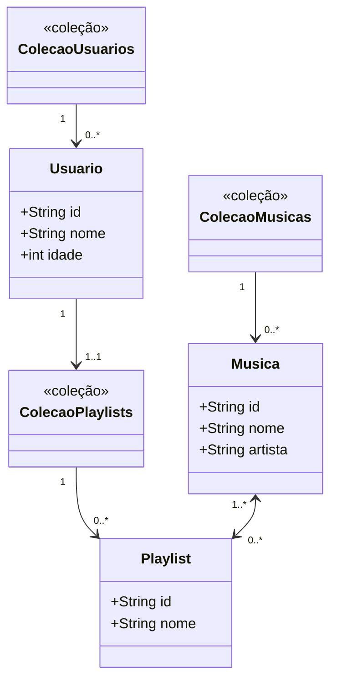

# Trabalho 6 – Comparação de Tecnologias de Invocação de Serviços Remotos

**Universidade de Fortaleza (UNIFOR)**  
**Disciplina:** Computação Distribuída / Sistemas Distribuídos  
**Professor:** Nabor C. Mendonça  

---

## 👥 Equipe

| Nome | Matrícula |
| :--- | :---: |
| **Amanda Lira Andrade Botelho** | 2320291 |
| **João Igor Vidal de Andrade** | 2320296 |
| **Raquel Albuquerque Quirino** | 2320325 |

---

## 1. Objetivo e Decisão Arquitetural

Este repositório implementa e compara quatro tecnologias de invocação de serviços remotos — **REST**, **SOAP**, **GraphQL** e **gRPC** — através de um **serviço de streaming de músicas**, seguido de **testes de carga comparativos** sob diferentes regimes de concorrência.

Seguindo a orientação definida em sala (**Opção B**):
- Cada entrega implementa **toda a interface da API em uma única tecnologia** (sem misturar protocolos na mesma API).
- São mantidas **8 entregas independentes** (4 protocolos × 2 linguagens: **Python** e **Java**), com **reaproveitamento do núcleo de domínio, repositório e regras de negócio** (`common`) entre as APIs de uma mesma linguagem.

| Tecnologia | Entrega Python | Porta Python | Entrega Java | Porta Java |
| :--- | :--- | :---: | :--- | :---: |
| **REST** | `python/rest_api` (FastAPI) | `8001` | `java/rest-api` (Spring Boot Web) | `8081` |
| **SOAP** | `python/soap_api` (FastAPI + XML/WSDL) | `8002` | `java/soap-api` (Spring Boot + XML/WSDL) | `8082` |
| **GraphQL** | `python/graphql_api` (Strawberry + FastAPI) | `8003` | `java/graphql-api` (Spring for GraphQL) | `8083` |
| **gRPC** | `python/grpc_api` (`grpcio`) | `50051` | `java/grpc-api` (`grpc-java` / Netty) | `50052` |

---

## 2. Modelo de Domínio e Operações Obrigatórias

O serviço gerencia (**criação, consulta, alteração e remoção**) três tipos de recursos relacionados entre si:



### Consultas Relacionais Obrigatórias (Especificação)
Todas as 8 APIs devem permitir:
1. Listar os dados de **todos os usuários** do serviço.
2. Listar os dados de **todas as músicas** mantidas pelo serviço.
3. Listar os dados de **todas as playlists de um determinado usuário**.
4. Listar os dados de **todas as músicas de uma determinada playlist**.
5. Listar os dados de **todas as playlists que contêm uma determinada música**.

Além das operações completas de **CRUD** para `Usuario`, `Musica` e `Playlist` (incluindo associação e remoção de músicas em playlists).

---

## 3. Estrutura do Repositório

```text
.
├── docs/                          # Enunciado em PDF e materiais de apresentação
├── contracts/                     # Contratos neutros de linguagem e dados iniciais
│   ├── openapi/openapi.yaml       # Especificação OpenAPI 3.0 (REST)
│   ├── soap/streaming.wsdl        # Contrato WSDL 1.1 + XSD (SOAP)
│   ├── graphql/schema.graphql     # Schema GraphQL SDL
│   ├── proto/streaming.proto      # Contrato Protobuf (gRPC)
│   └── seed/initial_data.json     # Dataset determinístico compartilhado
├── python/                        # Ecossistema Python (núcleo comum + 4 APIs)
│   ├── common/                    # Modelos, repositório em memória e StreamingService
│   ├── rest_api/                  # API REST (porta 8001)
│   ├── soap_api/                  # API SOAP (porta 8002)
│   ├── graphql_api/               # API GraphQL (porta 8003)
│   ├── grpc_api/                  # API gRPC (porta 50051)
│   ├── Dockerfile
│   └── requirements.txt
├── java/                          # Projeto Maven multi-módulo (Java 25 LTS+)
│   ├── pom.xml                    # Parent POM
│   ├── common/                    # Modelos, repositório em memória e StreamingService
│   ├── rest-api/                  # API REST (porta 8081)
│   ├── soap-api/                  # API SOAP (porta 8082)
│   ├── graphql-api/               # API GraphQL (porta 8083)
│   ├── grpc-api/                  # API gRPC (porta 50052)
│   └── Dockerfile
├── load_tests/                    # Testes de carga multi-protocolo (Locust)
│   └── locustfile.py
├── scripts/                       # Gerador de massa, smoke tests, benchmarks e gráficos
│   ├── generate_seed.py
│   ├── smoke_test.py
│   ├── run_benchmarks.py
│   └── plot_results.py
├── results/                       # CSVs brutos dos testes de carga
├── graficos/                      # Gráficos comparativos gerados
├── docker-compose.yml             # Orquestração dos 8 serviços
├── .env.example
└── .gitignore
```

---

## 4. Como Executar

### 4.1 Ambiente Python (Local com `.venv`)

```powershell
# Criar e ativar o ambiente virtual (testado em Python 3.14.3; Docker usa Python 3.12)
python -m venv .venv
.\.venv\Scripts\Activate.ps1
python -m pip install -r python/requirements.txt

# Definir PYTHONPATH e gerar os stubs gRPC a partir de contracts/proto/streaming.proto
$env:PYTHONPATH="python"
python -m grpc_api.generate_proto

# Subir cada serviço Python (a partir da raiz do repositório, com PYTHONPATH="python")
uvicorn rest_api.main:app --port 8001
uvicorn soap_api.main:app --port 8002
uvicorn graphql_api.main:app --port 8003
python -m grpc_api.main
```

### 4.2 Ambiente Java (Local com Maven)

```powershell
cd java
mvn clean package -DskipTests

# Executar cada módulo
java -jar rest-api/target/rest-api-1.0.0.jar
java -jar soap-api/target/soap-api-1.0.0.jar
java -jar graphql-api/target/graphql-api-1.0.0.jar
java -jar grpc-api/target/grpc-api-1.0.0.jar
```

### 4.3 Subir todos os 8 serviços via Docker Compose

```powershell
docker compose up -d --build
```

---

## 5. Massas de Dados, Smoke Tests, Benchmarks e Gráficos

> Com a `.venv` ativada (`.\.venv\Scripts\Activate.ps1`) ou usando `.\.venv\Scripts\python.exe`:

### 5.1 Gerar perfis de massa de dados (`small` e `large`)

```powershell
# Gera contracts/seed/seed_small.json (3-5 músicas/playlist) e seed_large.json (200 músicas/playlist)
python scripts/generate_seed.py --profile all

# Para subir o Docker Compose usando o dataset grande:
$env:SEED_DATA_PATH="/app/contracts/seed/seed_large.json"
docker compose up -d
```

### 5.2 Validar os 8 serviços ativos (Smoke Test)

```powershell
python scripts/smoke_test.py --langs python java --techs rest soap graphql grpc
```

### 5.3 Executar baterias Locust e gerar gráficos

```powershell
# Bateria com perfil pequeno (apenas leitura das 5 consultas do Slide 6)
python scripts/run_benchmarks.py --dataset small --workload read

# Executando o Locust dentro da rede Docker (recomendado para evitar overhead do host Windows)
python scripts/run_benchmarks.py --mode docker --dataset small --workload read

# Bateria com perfil grande (evidencia custo XML vs JSON vs Protobuf)
python scripts/run_benchmarks.py --mode docker --dataset large --workload read

# Bateria mista (leitura + criação/remoção) ou consulta aninhada (GraphQL vs múltiplas chamadas)
python scripts/run_benchmarks.py --mode docker --dataset small --workload mixed
python scripts/run_benchmarks.py --mode docker --dataset small --workload nested

# Gerar tabela consolidada e gráficos (latência, p95, RPS, falhas e payload médio em bytes) em graficos/
python scripts/plot_results.py
```
