# Trabalho 6 – Comparação de Tecnologias de Invocação de Serviços Remotos

**Universidade de Fortaleza (UNIFOR)**  
**Disciplina:** Computação Distribuída / Sistemas Distribuídos  
**Professor:** Nabor C. Mendonça  

---

## 👥 Equipe

| Nome | Matrícula |
| :--- | :---: |
| **Amanda Lira Andrade Botelho** | 2320291 |
| **João Igor Vidal de Andrade** | 2320296 |
| **Raquel Albuquerque Quirino** | 2320325 |

---

## 1. Objetivo e Decisão Arquitetural

Este repositório implementa e compara quatro tecnologias de invocação de serviços remotos — **REST**, **SOAP**, **GraphQL** e **gRPC** — através de um **serviço de streaming de músicas**, seguido de **testes de carga comparativos** sob diferentes regimes de concorrência.

Seguindo a orientação definida em sala (**Opção B**):
- Cada entrega implementa **toda a interface da API em uma única tecnologia** (sem misturar protocolos na mesma API).
- São mantidas **8 entregas independentes** (4 protocolos × 2 linguagens: **Python** e **Java**), com **reaproveitamento do núcleo de domínio, repositório e regras de negócio** (`common`) entre as APIs de uma mesma linguagem.

| Tecnologia | Entrega Python | Porta Python | Entrega Java | Porta Java |
| :--- | :--- | :---: | :--- | :---: |
| **REST** | `python/rest_api` (FastAPI) | `8001` | `java/rest-api` (Spring Boot Web) | `8081` |
| **SOAP** | `python/soap_api` (FastAPI + XML/WSDL) | `8002` | `java/soap-api` (Spring Boot + XML/WSDL) | `8082` |
| **GraphQL** | `python/graphql_api` (Strawberry + FastAPI) | `8003` | `java/graphql-api` (Spring for GraphQL) | `8083` |
| **gRPC** | `python/grpc_api` (`grpcio`) | `50051` | `java/grpc-api` (`grpc-java` / Netty) | `50052` |

---

## 2. Modelo de Domínio e Operações Obrigatórias

O serviço gerencia (**criação, consulta, alteração e remoção**) três tipos de recursos relacionados entre si:

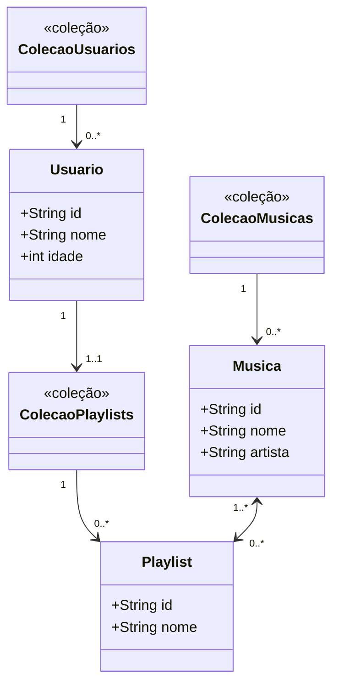

### Consultas Relacionais Obrigatórias (Especificação)
Todas as 8 APIs devem permitir:
1. Listar os dados de **todos os usuários** do serviço.
2. Listar os dados de **todas as músicas** mantidas pelo serviço.
3. Listar os dados de **todas as playlists de um determinado usuário**.
4. Listar os dados de **todas as músicas de uma determinada playlist**.
5. Listar os dados de **todas as playlists que contêm uma determinada música**.

Além das operações completas de **CRUD** para `Usuario`, `Musica` e `Playlist` (incluindo associação e remoção de músicas em playlists).

---

## 3. Estrutura do Repositório

```text
.
├── docs/                          # Enunciado em PDF e coleção do Insomnia
│   └── insomnia_collection.json   # Coleção Insomnia v4 (REST, SOAP, GraphQL e gRPC)
├── contracts/                     # Contratos neutros de linguagem e dados iniciais
│   ├── openapi/openapi.yaml       # Especificação OpenAPI 3.0 (REST)
│   ├── soap/streaming.wsdl        # Contrato WSDL 1.1 + XSD (SOAP)
│   ├── graphql/schema.graphql     # Schema GraphQL SDL
│   ├── proto/streaming.proto      # Contrato Protobuf (gRPC)
│   └── seed/                      # Datasets determinísticos compartilhados
│       ├── initial_data.json
│       ├── seed_small.json
│       └── seed_large.json
├── python/                        # Ecossistema Python (núcleo comum + 4 APIs)
│   ├── common/                    # Modelos, repositório em memória e StreamingService
│   ├── rest_api/                  # API REST (porta 8001)
│   ├── soap_api/                  # API SOAP (porta 8002)
│   ├── graphql_api/               # API GraphQL (porta 8003)
│   ├── grpc_api/                  # API gRPC (porta 50051)
│   ├── Dockerfile
│   └── requirements.txt
├── java/                          # Projeto Maven multi-módulo (Java 25 LTS+)
│   ├── pom.xml                    # Parent POM
│   ├── common/                    # Modelos, repositório em memória e StreamingService
│   ├── rest-api/                  # API REST (porta 8081)
│   ├── soap-api/                  # API SOAP (porta 8082)
│   ├── graphql-api/               # API GraphQL (porta 8083)
│   ├── grpc-api/                  # API gRPC (porta 50052)
│   └── Dockerfile
├── load_tests/                    # Testes de carga multi-protocolo (Locust)
│   └── locustfile.py
├── scripts/                       # Gerador de massa, demo, smoke tests, benchmarks e gráficos
│   ├── generate_seed.py
│   ├── demo_apis.py
│   ├── smoke_test.py
│   ├── run_benchmarks.py
│   └── plot_results.py
├── results/                       # CSVs brutos dos testes de carga
├── graficos/                      # Gráficos comparativos gerados
├── docker-compose.yml             # Orquestração dos 8 serviços
├── .env.example
└── .gitignore
```

---

## 4. Como Executar

### 4.1 Ambiente Python (Local com `.venv`)

```powershell
# Criar e ativar o ambiente virtual (testado em Python 3.14.3; Docker usa Python 3.12)
python -m venv .venv
.\.venv\Scripts\Activate.ps1
python -m pip install -r python/requirements.txt

# Definir PYTHONPATH e gerar os stubs gRPC a partir de contracts/proto/streaming.proto
$env:PYTHONPATH="python"
python -m grpc_api.generate_proto

# Subir cada serviço Python (a partir da raiz do repositório, com PYTHONPATH="python")
uvicorn rest_api.main:app --port 8001
uvicorn soap_api.main:app --port 8002
uvicorn graphql_api.main:app --port 8003
python -m grpc_api.main
```

### 4.2 Ambiente Java (Local com Maven)

```powershell
cd java
mvn clean package -DskipTests

# Executar cada módulo
java -jar rest-api/target/rest-api-1.0.0.jar
java -jar soap-api/target/soap-api-1.0.0.jar
java -jar graphql-api/target/graphql-api-1.0.0.jar
java -jar grpc-api/target/grpc-api-1.0.0.jar
```

### 4.3 Subir todos os 8 serviços via Docker Compose

```powershell
docker compose up -d --build
```

### 4.4 Demonstração das APIs (Insomnia, Playgrounds e Terminal)

Com os 8 serviços ativos utilizando os dados legíveis de [contracts/seed/initial_data.json](contracts/seed/initial_data.json):

```powershell
$env:SEED_DATA_PATH="/app/contracts/seed/initial_data.json"
docker compose up -d --force-recreate
```

1. **Via Insomnia (REST, SOAP, GraphQL e gRPC em um só lugar):**
   - Importe o arquivo [docs/insomnia_collection.json](docs/insomnia_collection.json) no Insomnia (`Ctrl+I`).
   - Alterne o ambiente entre **`Python (8001-8003 / 50051)`** e **`Java (8081-8083 / 50052)`** para disparar todas as consultas obrigatórias e operações CRUD nas pastas **`1. REST`**, **`2. SOAP`**, **`3. GraphQL`** e **`4. gRPC`**.
2. **Via Interfaces Interativas no Navegador:**
   - **REST (Swagger UI Python):** `http://localhost:8001/docs`
   - **GraphQL (GraphiQL):** `http://localhost:8003/graphql` (Python) e `http://localhost:8083/graphiql` (Java)
   - **SOAP (Contrato WSDL):** `http://localhost:8002/soap?wsdl` (Python) e `http://localhost:8082/soap?wsdl` (Java)
3. **Via Script de Demonstração no Terminal:**
   ```powershell
   .\.venv\Scripts\Activate.ps1
   python scripts/demo_apis.py
   # ou filtrando por linguagem/tecnologia:
   python scripts/demo_apis.py --techs grpc --langs python java
   ```

---

## 5. Massas de Dados, Smoke Tests, Benchmarks e Gráficos

> Com a `.venv` ativada (`.\.venv\Scripts\Activate.ps1`) ou usando `.\.venv\Scripts\python.exe`:

### 5.1 Gerar perfis de massa de dados (`small` e `large`)

```powershell
# Gera contracts/seed/seed_small.json (3-5 músicas/playlist) e seed_large.json (200 músicas/playlist)
python scripts/generate_seed.py --profile all

# Para subir o Docker Compose usando o dataset grande:
$env:SEED_DATA_PATH="/app/contracts/seed/seed_large.json"
docker compose up -d
```

### 5.2 Validar os 8 serviços ativos (Smoke Test)

```powershell
python scripts/smoke_test.py --langs python java --techs rest soap graphql grpc
```

### 5.3 Executar baterias Locust e gerar gráficos

```powershell
# Bateria com perfil pequeno (apenas leitura das 5 consultas do Slide 6)
python scripts/run_benchmarks.py --dataset small --workload read

# Executando o Locust dentro da rede Docker (recomendado para evitar overhead do host Windows)
python scripts/run_benchmarks.py --mode docker --dataset small --workload read

# Bateria com perfil grande (evidencia custo XML vs JSON vs Protobuf)
python scripts/run_benchmarks.py --mode docker --dataset large --workload read

# Bateria mista (leitura + criação/remoção) ou consulta aninhada (GraphQL vs múltiplas chamadas)
python scripts/run_benchmarks.py --mode docker --dataset small --workload mixed
python scripts/run_benchmarks.py --mode docker --dataset small --workload nested

# Gerar tabela consolidada e gráficos (latência, p95, RPS, falhas e payload médio em bytes) em graficos/
python scripts/plot_results.py
```

---

## 6. Metodologia dos Testes de Carga

- **Ferramenta e Isolamento de Rede:** **Locust 2.47.0** em modo *headless*, executando em container próprio dentro da rede interna `streaming-net` do Docker Compose (`--mode docker`), eliminando o overhead de *port forwarding* do host Windows.
- **Níveis de Concorrência Avaliados:** **10, 50, 100 e 200** usuários virtuais simultâneos (duração de 30 s por bateria, `wait_time` de 0,2 s a 0,8 s).
- **Perfis de Carga de Trabalho (`128` baterias no total):**
  1. **`small / read`**: 5 consultas obrigatórias de leitura sobre massa pequena (3–5 músicas/playlist).
  2. **`small / mixed`**: 5 consultas de leitura + ciclo de criação e remoção de usuário em todos os protocolos.
  3. **`small / nested`**: consulta composta (`usuario → playlists → músicas`), comparando **1 requisição GraphQL** contra múltiplas chamadas encadeadas em REST, SOAP e gRPC.
  4. **`large / read`**: 5 consultas obrigatórias sobre massa grande (**200 músicas por playlist**), destacando o impacto real de serialização (XML vs. JSON vs. Protobuf).
- **Confiabilidade:** todas as **705.067 requisições** distribuídas nas **128 baterias** foram concluídas com **0 falhas (0,0%)**.

---

## 7. Resultados Consolidados e Gráficos

> Planilha consolidada com todas as 128 baterias: [graficos/tabela_desempenho.csv](graficos/tabela_desempenho.csv)

### 7.1 Massa Grande – Leitura (`large / read`, 200 usuários simultâneos)

| Cenário | Reqs Totais | Falhas | Tempo Médio | Mediana (p50) | p95 | Vazão (RPS) | Payload Médio |
| :--- | :---: | :---: | :---: | :---: | :---: | :---: | :---: |
| **Java - gRPC** | 7.924 | 0% | **1,86 ms** | **2,0 ms** | **3,0 ms** | 268,56 req/s | 11.032 bytes |
| **Java - REST** | 7.910 | 0% | 6,15 ms | 4,0 ms | 20,0 ms | 268,62 req/s | 15.831 bytes |
| **Java - SOAP** | 7.878 | 0% | 6,46 ms | 4,0 ms | 19,0 ms | 268,55 req/s | **48.733 bytes** |
| **Java - GraphQL** | 7.919 | 0% | 6,49 ms | 4,0 ms | 20,0 ms | **269,40 req/s** | **10.208 bytes** |
| **Python - gRPC** | 7.445 | 0% | **2,44 ms** | **2,0 ms** | **5,0 ms** | 260,03 req/s | 11.223 bytes |
| **Python - REST** | 7.751 | 0% | 12,43 ms | 7,0 ms | 41,0 ms | 264,09 req/s | 15.932 bytes |
| **Python - SOAP** | 5.912 | 0% | 167,53 ms | 130,0 ms | 420,0 ms | 201,55 req/s | **48.727 bytes** |
| **Python - GraphQL** | 4.063 | 0% | 464,50 ms | 470,0 ms | 890,0 ms | 138,41 req/s | **10.471 bytes** |

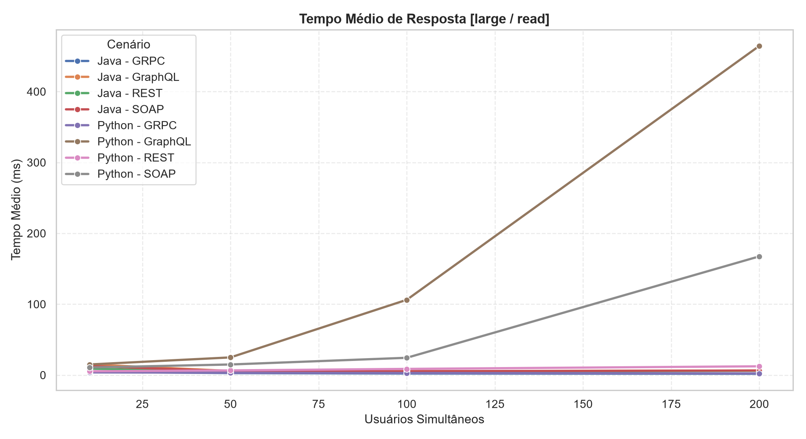
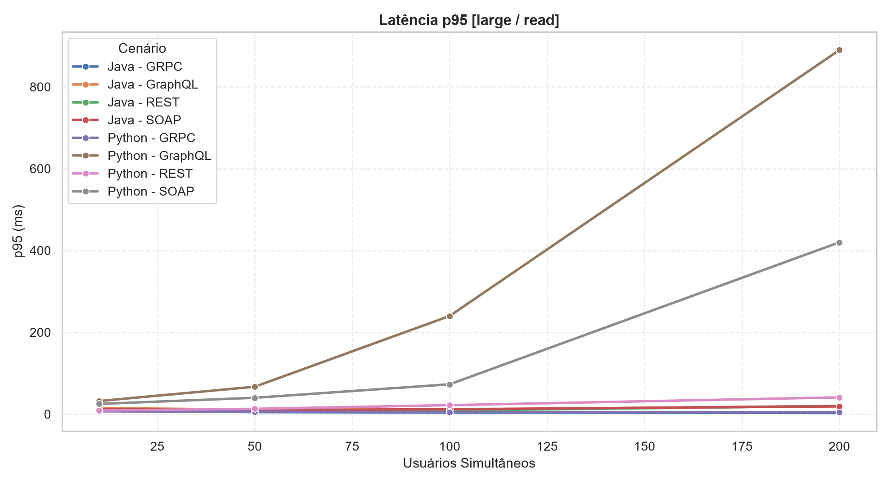
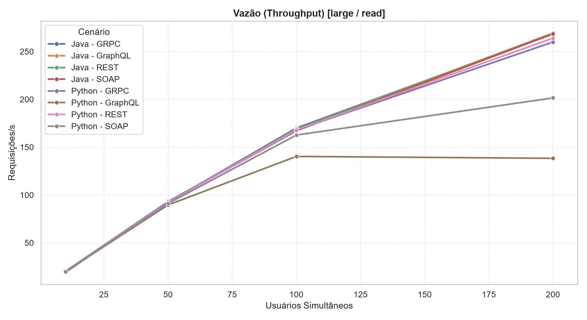
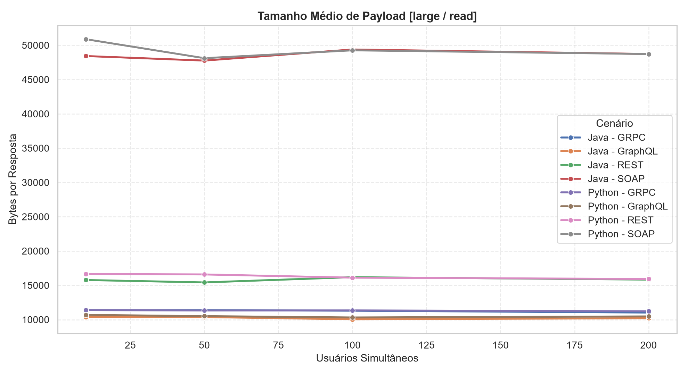


### 7.2 Massa Pequena – Leitura (`small / read`, 200 usuários simultâneos)

| Cenário | Reqs Totais | Falhas | Tempo Médio | Mediana (p50) | p95 | Vazão (RPS) | Payload Médio |
| :--- | :---: | :---: | :---: | :---: | :---: | :---: | :---: |
| **Java - gRPC** | 7.935 | 0% | **0,63 ms** | **1,0 ms** | **1,0 ms** | **270,63 req/s** | **298 bytes** |
| **Java - REST** | 7.905 | 0% | 4,83 ms | 3,0 ms | 14,0 ms | 269,54 req/s | 461 bytes |
| **Java - GraphQL** | 7.922 | 0% | 5,72 ms | 4,0 ms | 18,0 ms | 269,35 req/s | 443 bytes |
| **Java - SOAP** | 7.938 | 0% | 5,92 ms | 4,0 ms | 18,0 ms | 269,42 req/s | 1.271 bytes |
| **Python - gRPC** | 7.531 | 0% | **1,72 ms** | **2,0 ms** | **3,0 ms** | 263,04 req/s | **286 bytes** |
| **Python - SOAP** | 7.886 | 0% | 6,05 ms | 4,0 ms | 17,0 ms | 268,19 req/s | 1.327 bytes |
| **Python - REST** | 7.872 | 0% | 8,16 ms | 5,0 ms | 25,0 ms | 267,51 req/s | 502 bytes |
| **Python - GraphQL** | 6.664 | 0% | 95,16 ms | 87,0 ms | 250,0 ms | 227,16 req/s | 528 bytes |

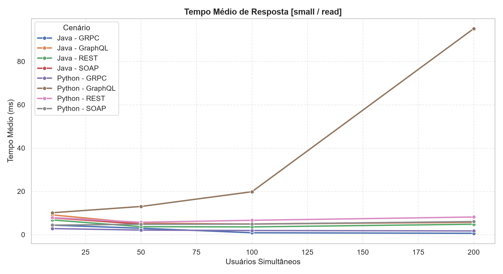
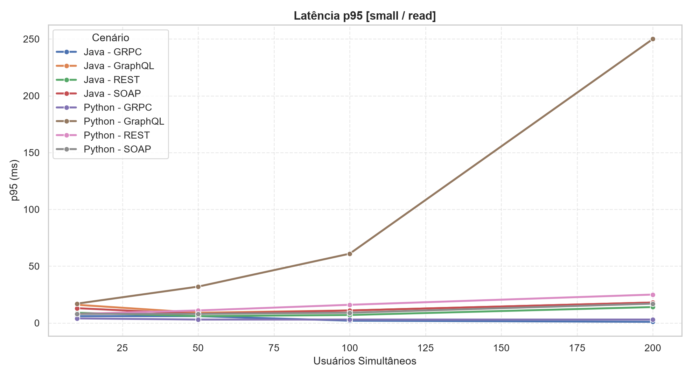
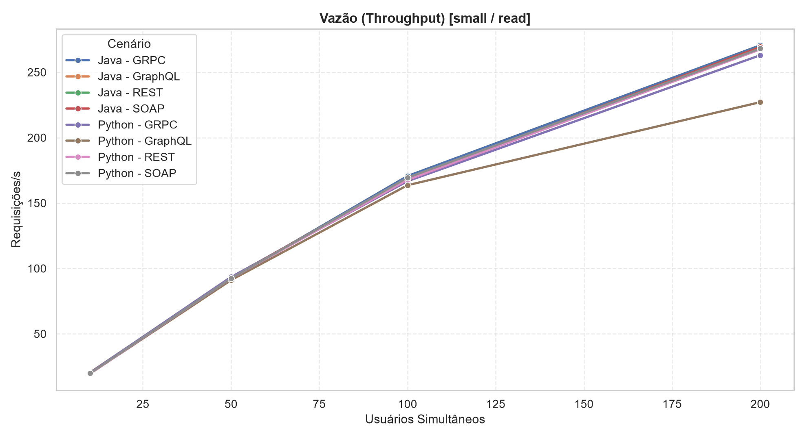
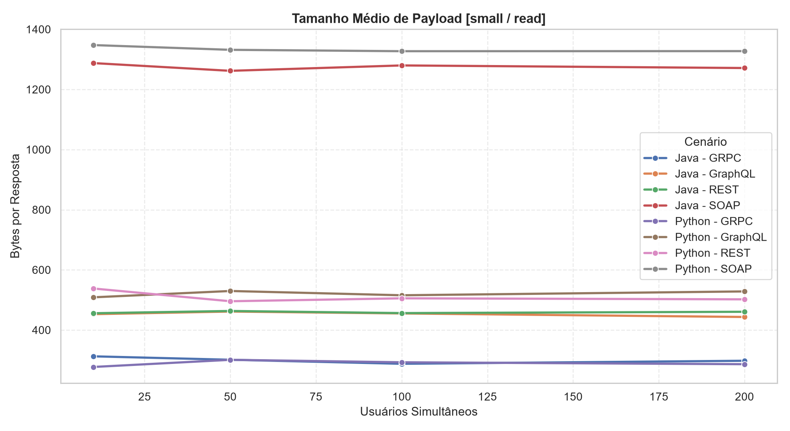
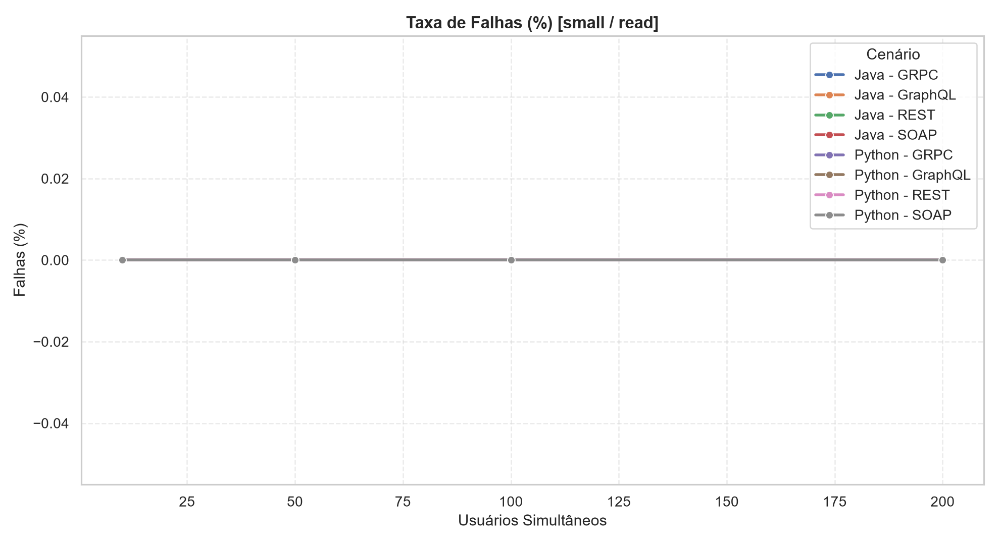

### 7.3 Massa Pequena – Mista (`small / mixed`, 200 usuários simultâneos)

| Cenário | Reqs Totais | Falhas | Tempo Médio | Mediana (p50) | p95 | Vazão (RPS) | Payload Médio |
| :--- | :---: | :---: | :---: | :---: | :---: | :---: | :---: |
| **Java - gRPC** | 8.573 | 0% | **1,55 ms** | **1,0 ms** | **3,0 ms** | 290,76 req/s | **248 bytes** |
| **Java - REST** | 8.607 | 0% | 4,85 ms | 3,0 ms | 14,0 ms | 291,87 req/s | 388 bytes |
| **Java - SOAP** | 8.603 | 0% | 5,50 ms | 4,0 ms | 15,0 ms | **293,81 req/s** | 1.123 bytes |
| **Java - GraphQL** | 8.539 | 0% | 6,36 ms | 4,0 ms | 20,0 ms | 289,83 req/s | 417 bytes |
| **Python - gRPC** | 8.531 | 0% | **1,92 ms** | **2,0 ms** | **3,0 ms** | 289,62 req/s | **245 bytes** |
| **Python - SOAP** | 8.553 | 0% | 6,06 ms | 4,0 ms | 17,0 ms | 291,28 req/s | 1.183 bytes |
| **Python - REST** | 8.512 | 0% | 7,65 ms | 5,0 ms | 22,0 ms | 290,29 req/s | 427 bytes |
| **Python - GraphQL** | 6.665 | 0% | 131,60 ms | 150,0 ms | 270,0 ms | 227,34 req/s | 487 bytes |

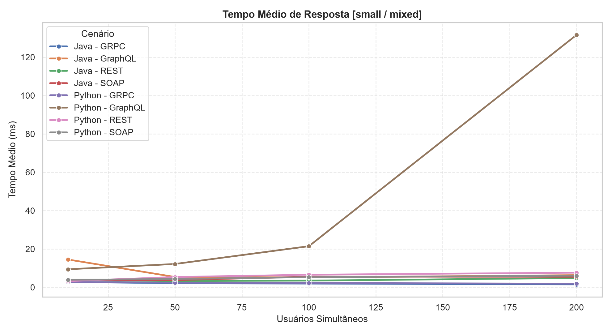
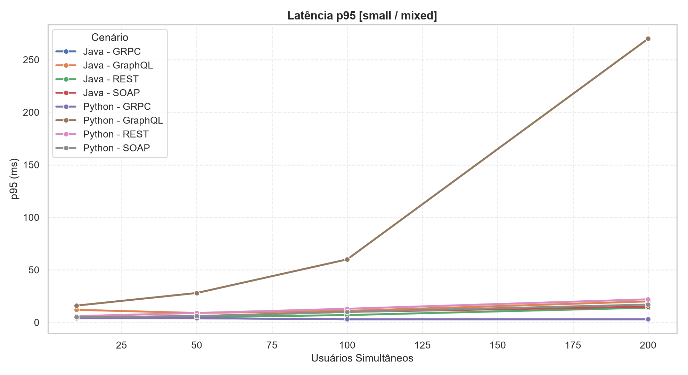
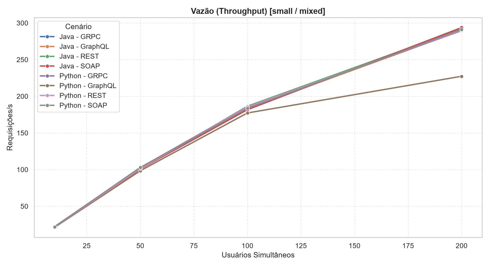
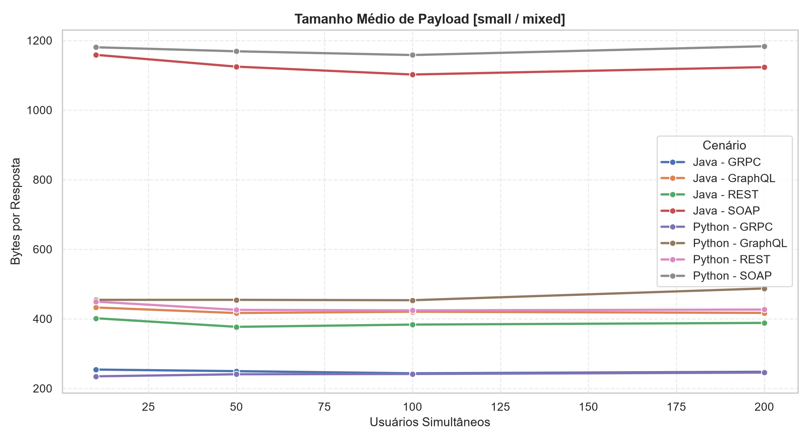


### 7.4 Massa Pequena – Consultas Aninhadas (`small / nested`, 200 usuários simultâneos)

| Cenário | Reqs Totais | Falhas | Tempo Médio | Mediana (p50) | p95 | Vazão (RPS) | Payload Médio |
| :--- | :---: | :---: | :---: | :---: | :---: | :---: | :---: |
| **Java - gRPC** | 25.474 | 0% | **0,83 ms** | **1,0 ms** | **2,0 ms** | 880,01 req/s | **99 bytes** |
| **Java - GraphQL** *(1 req/ciclo)* | 7.892 | 0% | 5,66 ms | 4,0 ms | 16,0 ms | 268,83 req/s | 408 bytes |
| **Java - SOAP** | 26.543 | 0% | 6,55 ms | 4,0 ms | 23,0 ms | **909,45 req/s** | 613 bytes |
| **Java - REST** | 18.821 | 0% | 54,50 ms | 47,0 ms | 140,0 ms | 655,97 req/s | 149 bytes |
| **Python - gRPC** | 16.980 | 0% | **1,54 ms** | **1,0 ms** | **2,0 ms** | 533,64 req/s | **99 bytes** |
| **Python - REST** | 19.426 | 0% | 55,80 ms | 46,0 ms | 150,0 ms | 667,25 req/s | 170 bytes |
| **Python - SOAP** | 18.543 | 0% | 63,42 ms | 58,0 ms | 160,0 ms | 641,89 req/s | 645 bytes |
| **Python - GraphQL** *(1 req/ciclo)* | 4.281 | 0% | 383,49 ms | 390,0 ms | 810,0 ms | 148,78 req/s | 429 bytes |

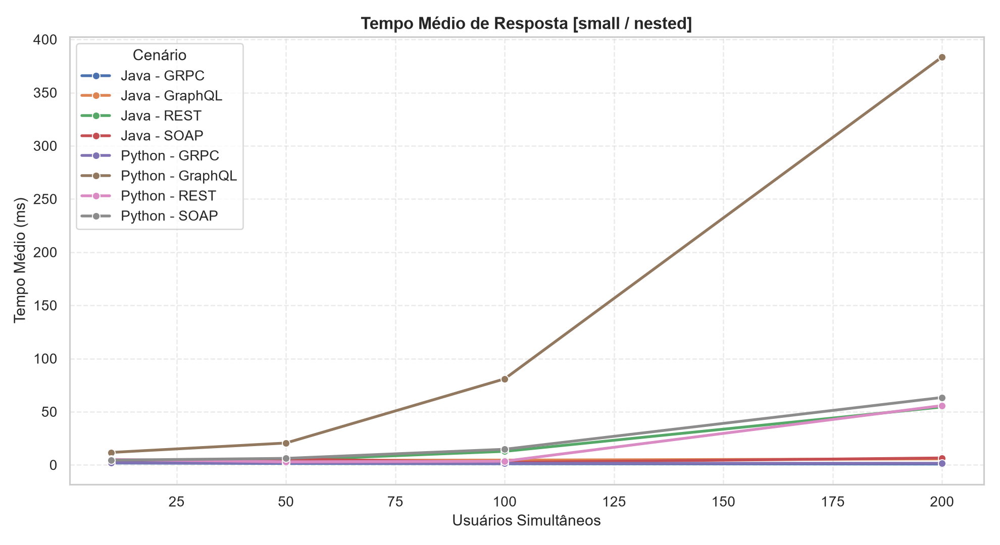
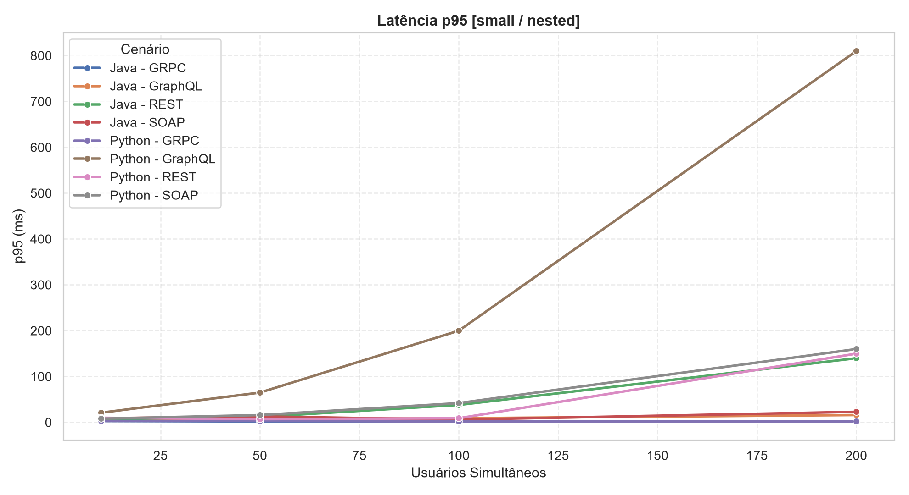
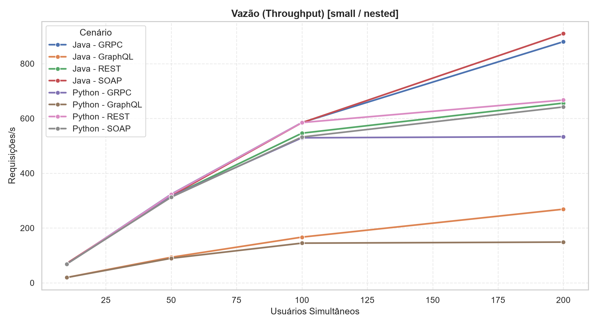
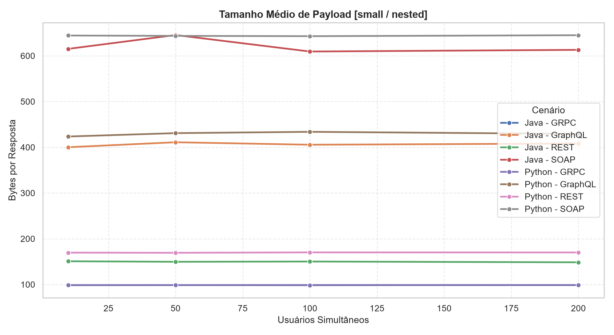
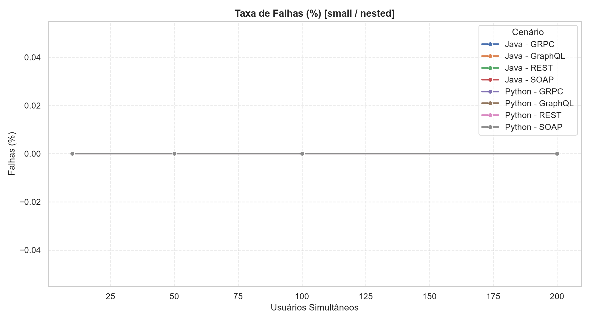

---

## 8. Análise Crítica e Principais Conclusões Técnicas

1. **Impacto da Serialização no Tamanho de Payload (`large / read`):**
   - **SOAP (XML)** gerou payloads em média **~48,7 KB**, cerca de **3,1× maiores que REST (JSON, ~15,9 KB)** e **4,4× maiores que gRPC (Protobuf, ~11,1 KB)**, em função da verbosidade das tags XML com namespace repetidas para cada música.
   - **GraphQL (~10,3 KB)** atingiu o menor tráfego médio no `large / read` por retornar apenas os campos requisitados na query (eliminando *over-fetching*), enquanto o **gRPC (~11,1 KB)** manteve compactação binária sem repetição de nomes de campo e menor custo de CPU.
2. **Desempenho sob Payloads Grandes e Alta Concorrência:**
   - **gRPC liderou em ambas as linguagens** sob 200 usuários em `large / read`: **1,86 ms** (p95 **3,0 ms**) em Java e **2,44 ms** (p95 **5,0 ms**) em Python, beneficiado por HTTP/2 multiplexado e Protobuf binário.
   - Em **Java** (servidores multi-thread Tomcat/Netty), REST (`6,15 ms`), SOAP (`6,46 ms`) e GraphQL (`6,49 ms`) mantiveram latência baixa e vazão estável (~269 req/s).
   - Em **Python** (`uvicorn` em processo único), o aumento do payload para 200 músicas/playlist expôs o gargalo de serialização em processo único: SOAP saltou de `6,05 ms` (`small`) para **167,53 ms** (`large`, p95 de `420 ms`), e GraphQL (Strawberry) atingiu **464,50 ms** (p95 de `890 ms`, caindo para `138,41 req/s`).
3. **Consultas Aninhadas e *Under-fetching* (`small / nested`):**
   - Para recuperar usuário + playlists + músicas, **GraphQL resolveu em 1 única requisição por ciclo** (`5,66 ms` no Java, `7.892` requisições totais), enquanto REST, SOAP e gRPC precisaram de múltiplas chamadas encadeadas (`18.821` a `26.543` requisições totais).
   - Sob 200 usuários no `nested`, o **Java GraphQL** manteve `5,66 ms` por operação completa, enquanto as chamadas em cascata elevaram o tempo médio individual do **REST** para `54,50 ms` (Java) e `55,80 ms` (Python); já o **gRPC** absorveu as ~25,5 mil RPCs em `0,83 ms` médios graças à multiplexação HTTP/2.
4. **Estabilidade de Conexões (`0,0%` de falhas):**
   - Após o ajuste de *keep-alive* no Tomcat embutido (`max-keep-alive-requests=-1`), todas as **705.067 requisições** das 128 baterias encerraram com **0% de falha**.
